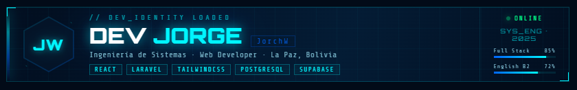

<!-- =========================================================
     DEVJORGE — GITHUB PROFILE
     Design: Dark / Neon Green / Digital Craft
     Author: Jorge Wilmer Choque Nina (@JorchW)
========================================================= -->

<!-- HERO -->
<div align="center">

  

  <br/>

  

  <br/>

  <p>
    <a href="https://devjorgev.vercel.app/">
      
    </a>
    <a href="https://github.com/JorchW">
      
    </a>
    <a href="https://www.linkedin.com/in/jorchw">
      
    </a>
  </p>

  

</div>

<br/>

<!-- INTRODUCTION -->
<table>
<tr>
<td width="65%" valign="middle">

## `01` / ABOUT ME

### Hola, soy Jorge. 👋

Soy **Ingeniero de Sistemas y desarrollador web Full Stack**, de La Paz, Bolivia.

Me especializo en construir, mejorar y mantener plataformas web, desarrollar sistemas de información y convertir necesidades reales en soluciones digitales funcionales.

Tengo experiencia práctica trabajando con aplicaciones existentes, bases de datos, interfaces web, sistemas de inventario, sitios corporativos y despliegues.

Actualmente soy fundador y desarrollador web en **UrsuStudio**, un estudio digital independiente enfocado en landing pages a medida.

**Mi filosofía:** entender el problema, construir una solución y llevarla hasta producción.

</td>
<td width="35%" valign="middle">

```javascript
const jorge = {
  alias: "JorchW",
  role: "Full Stack Developer",
  location: "Bolivia 🇧🇴",
  frontend: ["React", "JavaScript"],
  backend: ["PHP", "Laravel"],
  database: ["PostgreSQL", "MySQL"],
  focus: [
    "Web development",
    "Information systems",
    "Digital products"
  ],
  currently: "Building with UrsuStudio"
};
```

</td>
</tr>
</table>

---

<!-- QUICK INFO -->
<div align="center">

## `02` / DEVELOPER SNAPSHOT

<table>
<tr>
<td align="center" width="25%">

**01**

<br/>

🖥️

<br/>

**FULL STACK**

<br/>

<sub>Frontend + Backend</sub>

</td>
<td align="center" width="25%">

**02**

<br/>

🗄️

<br/>

**DATABASES**

<br/>

<sub>PostgreSQL · MySQL</sub>

</td>
<td align="center" width="25%">

**03**

<br/>

🚀

<br/>

**DEPLOYMENT**

<br/>

<sub>Vercel · Netlify · Railway</sub>

</td>
<td align="center" width="25%">

**04**

<br/>

💡

<br/>

**DIGITAL CRAFT**

<br/>

<sub>UrsuStudio</sub>

</td>
</tr>
</table>

</div>

---

<!-- TECH STACK -->
<div align="center">

## `03` / TOOLS OF THE TRADE

<sub>Technologies and tools I use to build digital solutions.</sub>

<br/><br/>

### FRONTEND


### BACKEND & DATABASES


### DEVELOPMENT & DEPLOYMENT


</div>

<details>
<summary><strong>View complete technology stack</strong></summary>

<br/>

| Category | Technologies |
|:--|:--|
| Frontend | ReactJS, Vite, JavaScript, HTML5, CSS3, TailwindCSS, Bootstrap |
| Backend | PHP, Laravel, API integration |
| Databases | PostgreSQL, MySQL, Supabase |
| CMS & E-commerce | WordPress, Elementor, WooCommerce |
| Version control | Git, GitHub |
| Package management | NPM |
| Deployment | Vercel, Netlify, Railway |

</details>

---

<!-- PROJECTS -->
<div align="center">

## `04` / SELECTED PROJECTS

<sub>Real-world systems, web development and digital experiences.</sub>

</div>

<table>
<tr>
<td width="50%" valign="top">

### 📦 01. EMBAL — Inventory System

**Internal purchasing and inventory management system.**

Developed from scratch to support inventory operations and improve stock control.

**Key features**

- Real-time stock management.
- Expiration and reorder alerts.
- Physical product locations.
- Role-based user permissions.
- PDF reports and audit logs.

**Stack**

`Laravel` `PostgreSQL` `JavaScript` `TailwindCSS`

</td>
<td width="50%" valign="top">

### 🌐 02. SENAVEX — Export Directory

**Institutional platform for promoting Bolivian products.**

Contributed to the maintenance and improvement of the public website and private administration panel.

**Key contributions**

- Code refactoring and maintenance.
- Company and user registration.
- PostgreSQL data persistence.
- Product interface improvements.
- Functional testing before deployment.

**Stack**

`PHP` `Laravel` `PostgreSQL` `Bootstrap`

</td>
</tr>
<tr>
<td width="50%" valign="top">

### 🛍️ 03. CASAPIEL — Web Administration

**Corporate website and e-commerce management.**

Rebuilt the website using WordPress and integrated tools for catalog management and business operations.

**Key contributions**

- WordPress migration.
- Elementor-compatible website.
- WooCommerce integration.
- Product catalog and price management.
- Technical maintenance and corporate email administration.

**Stack**

`WordPress` `Elementor` `WooCommerce`

</td>
<td width="50%" valign="top">

### 🚀 04. UrsuStudio — Digital Studio

**Independent web design and development.**

Building customized landing pages and digital experiences for projects and businesses.

**Focus**

- Custom landing pages.
- Modern web interfaces.
- Responsive design.
- Website publishing and deployment.

**Approach**

`Design` `Development` `Deployment`

</td>
</tr>
</table>

<div align="center">

  <a href="https://devjorgev.vercel.app/">
    
  </a>

</div>

---

<!-- EXPERIENCE -->
## `05` / EXPERIENCE TIMELINE

<table>
<tr>
<td width="20%" valign="top">

**2026 — NOW**

</td>
<td valign="top">

### Founder & Web Developer — UrsuStudio

- Founded an independent digital studio.
- Design and development of custom landing pages.
- Creation and publication of web experiences.

</td>
</tr>
<tr>
<td valign="top">

**2025**

</td>
<td valign="top">

### Web Administrator / IT Support — CASAPIEL

- Migrated and rebuilt a corporate website.
- Integrated WordPress, Elementor and WooCommerce.
- Managed technical maintenance and corporate email accounts.

</td>
</tr>
<tr>
<td valign="top">

**2025**

</td>
<td valign="top">

### Web Developer — EMBAL

- Built an internal purchasing and inventory system.
- Implemented stock control and automated alerts.
- Developed role management, PDF reports and audit logging.

</td>
</tr>
<tr>
<td valign="top">

**2024**

</td>
<td valign="top">

### Systems Intern — SENAVEX

- Refactored and maintained institutional web applications.
- Implemented company and user registration.
- Improved product interfaces and tested functionality before deployment.

</td>
</tr>
</table>

---

<!-- GITHUB ANALYTICS -->
<div align="center">

## `06` / GITHUB ANALYTICS

<sub>A snapshot of my public development activity.</sub>

<br/><br/>


<br/><br/>


</div>

---

<!-- EDUCATION & LANGUAGES -->
<div align="center">

## `07` / BACKGROUND

<table>
<tr>
<td width="50%" valign="top">

### 🎓 Education

**Ingeniería de Sistemas**

Universidad Tecnológica Boliviana (UTB)

La Paz, Bolivia

Graduated / Egresado — November 2025

</td>
<td width="50%" valign="top">

### 🌎 Languages

**Spanish** — Native

**English** — B1, Intermediate

<br/>

### 🎮 Beyond the code

Technology · Gaming · Music · Continuous learning

</td>
</tr>
</table>

</div>

---

<!-- CONTACT -->
<div align="center">

## `08` / LET'S CONNECT

### Have an idea? Let's build something meaningful.

I'm open to connecting with developers, teams and businesses interested in web development, digital products and technology.

<br/>

<a href="mailto:Jorgejwcn27_27@hotmail.com">
  
</a>
<a href="https://www.linkedin.com/in/jorchw">
  
</a>
<a href="https://devjorgev.vercel.app/">
  
</a>

<br/><br/>

📍 **La Paz, Bolivia 🇧🇴**

<br/>


<sub>Designed with purpose by <strong>JorchW</strong>.</sub>

<sub>One idea. One solution. One line of code at a time.</sub>

</div>
